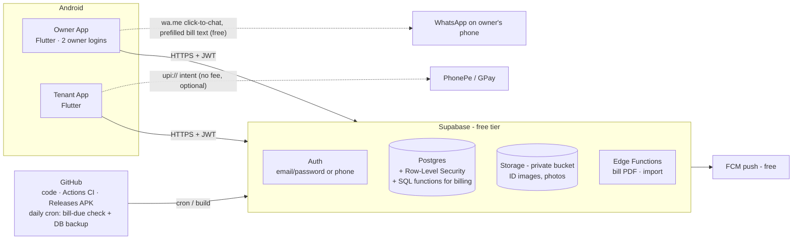
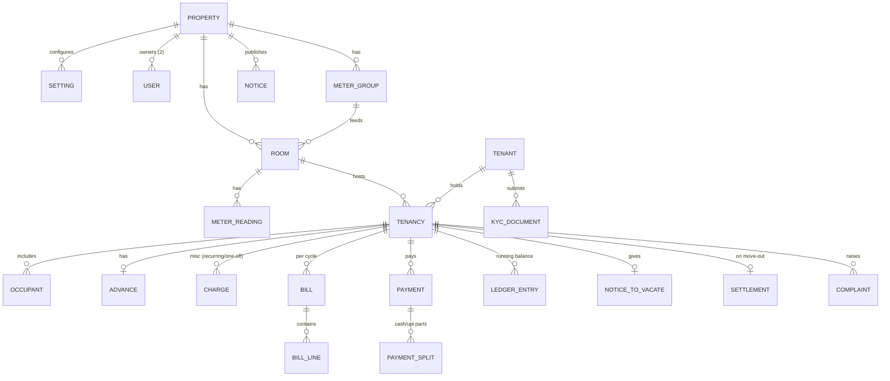
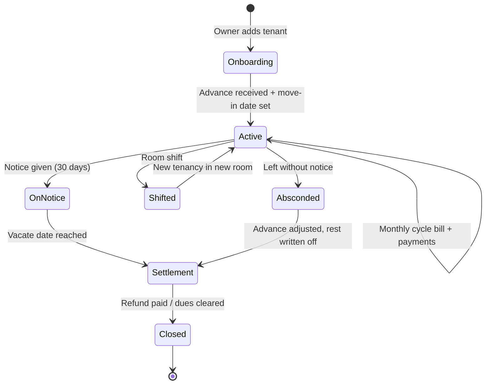
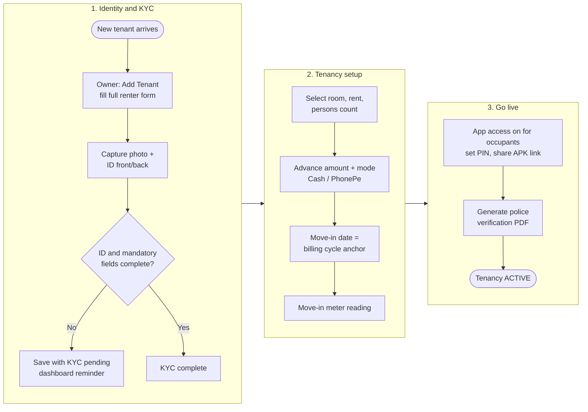
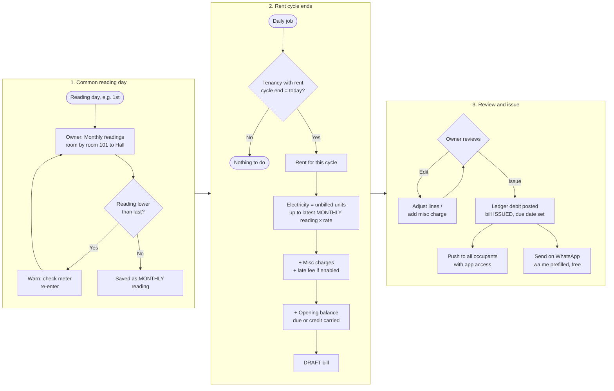
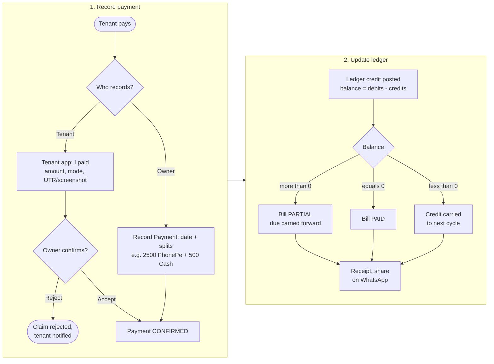
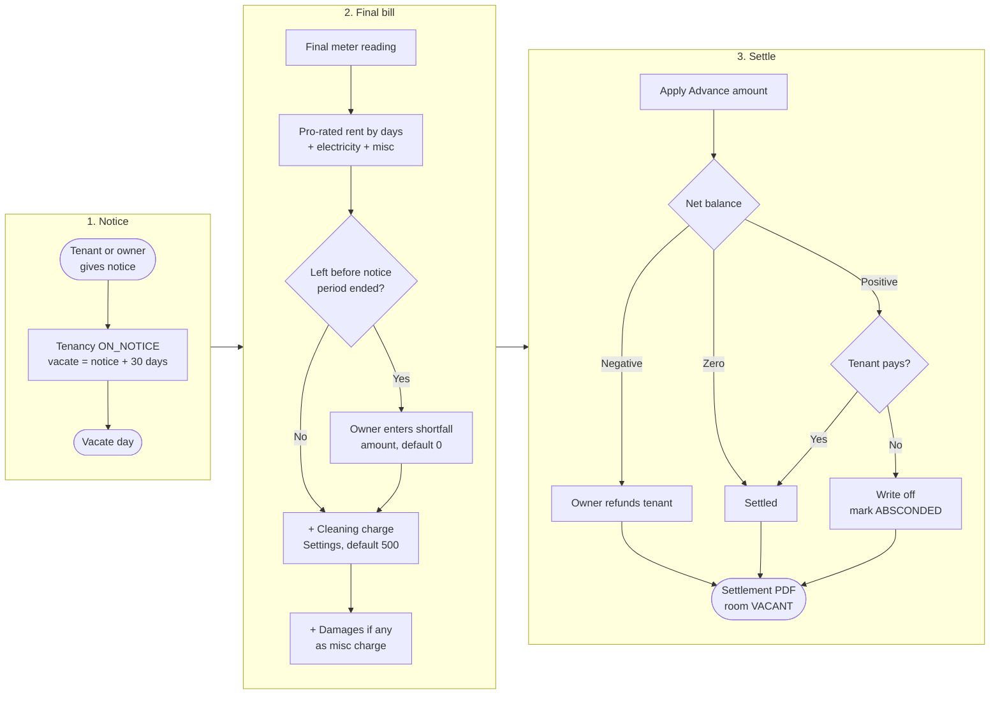
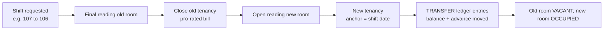
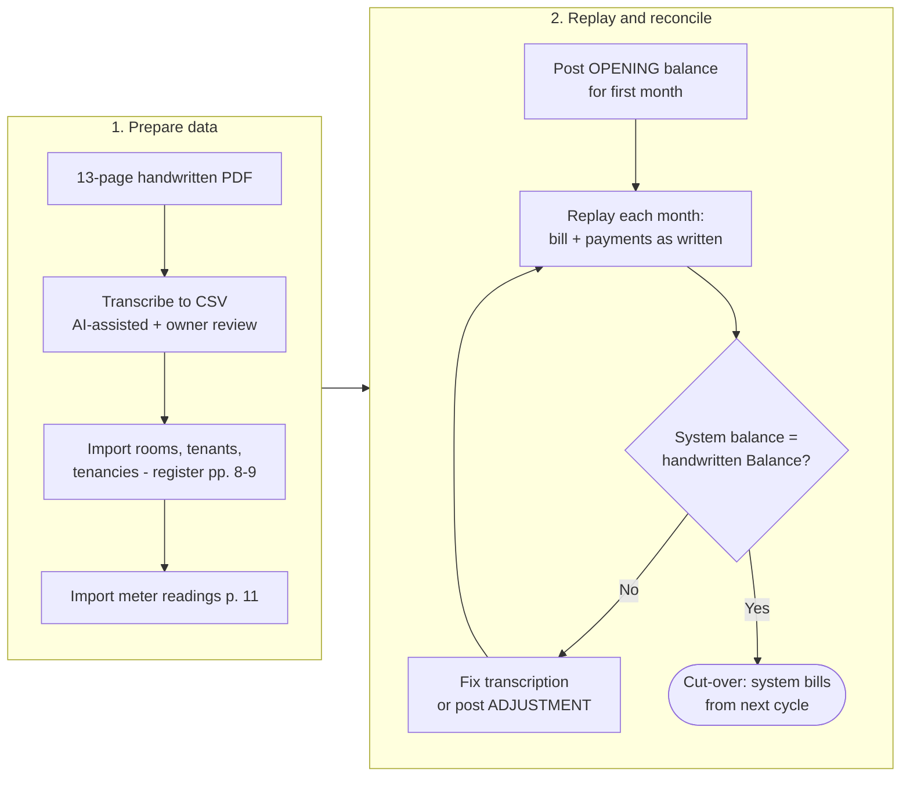

# Tenant Management System — High-Level Design (v0.4)

> Source: `Tanent 03-Sep-2026 15-25-53.pdf`, a set of handwritten rent ledgers, the tenant register, the renter info form and electricity meter sheets covering about 6 months.
> Status: **v0.2 includes the owner's answers (2026-11-16).** Section 14 lists the decisions and section 15 lists the questions still open.

### Changelog
- **v0.4:** English by default with a Hindi option, both in plain everyday words. Added UX principles (§8.0). Every occupant can log in. Notice shortfall, due date, grace period and late fee are owner-defined. **Meters are read on one common day**, so electricity is billed from the common reading while rent follows each tenant's move-in cycle. No Play Store: APK only. Electricity adjustments are handled as a normal adjustment.
- **v0.3:** Added process flowcharts (lifecycle, onboarding, bill cycle, payment, move-out, room shift, migration) and a Word (.docx) export.
- **v0.2:** Single property. Two owner logins share one dataset. Billing cycle starts from each tenant's move-in date. Electricity rate (default ₹12) and cleaning charge (default ₹500) are editable in Settings. The deposit is stored as an **Advance amount**. Notice period is 1 month. Miscellaneous charges can have custom labels. No payment gateway: payments are recorded like Splitwise entries. WhatsApp reminders use free click-to-chat. All renter-form fields are kept. All 6 months of history are imported. Android only, on zero-cost hosting, with the APK on GitHub Releases (Play Store optional).
- **v0.1:** Initial draft.

---

## 1. Problem statement

The owner owns a rental building with about 15 rooms. Today it runs on paper registers:

- Every month he reads each room's electricity sub-meter by hand, works out units × ₹12, and adds rent plus any carried-forward balance.
- Payments arrive in parts, over several dates, and by different methods (Cash and PhonePe). They are written into the margins.
- Balances (dues or credits) are carried into the next month's page by hand, which is easy to get wrong.
- Tenant identity details (name, father's name, address, parents' phone, ID copies) are kept on paper for police verification. Some tenants left without submitting IDs.
- Several tenants moved out suddenly with rent and electricity still unpaid ("अचानक कमरा खाली किया, किराया और बिजली बिल बाकी है"), and the advance was adjusted against the dues by hand.

**Goal:** Replace the registers with two apps on a shared backend:

- **Owner App:** the two owners (father and Himanshu, each with their own login, sharing the same data) manage rooms, tenants, meter readings, bills, payments, dues, KYC and move-outs.
- **Tenant App:** tenants see their bill and ledger, pay over UPI, upload KYC, raise complaints and receive notices.

## 2. Findings from the ledger (what the system must model)

| # | Observation in PDF | System implication |
|---|---|---|
| F1 | Rooms 101–107 (+108) on **Meter 1** and 201–207 + **Hall** on **Meter 2** | Property → Meter group → Room. A room has its own sub-meter. |
| F2 | Page header says "April paid in May 2026": a month's rent is collected the next month | Bill period (April) is separate from the collection window (May). Billing is in arrears. |
| F3 | Electricity is "prev reading → current reading = units × @₹12" (e.g. 14 units = ₹168) | `MeterReading` per room per period. The tariff is configurable, with ₹12/unit as the default. |
| F4 | Total = Previous Balance + Fair (rent) + Electricity (+ extras) | The bill is built from line items. The opening balance is carried forward automatically. |
| F5 | Balance can be due, or a credit written "+44" / "+4840" | The ledger keeps a signed running balance, and credits are applied to the next bill. |
| F6 | Payments like "2500 PhonePe + 500 cash" are spread over several dates | One bill can have many payments. Each payment has a mode, date and reference. Partial payments are allowed. |
| F7 | Extra recurring/one-off charges: "Fan 420" (room 201), damage (broken door), "Medicine 120" deduction, electricity bill adjustments | `Charge`/`Adjustment` line items, either recurring or one-off, as debit or credit. |
| F8 | "1 month" advance, "Ad. 4000", advance amounts from ₹1,700 to ₹4,000 | `SecurityDeposit` per tenancy, adjusted at move-out. |
| F9 | Move-in "Date of Rent"; rooms shifted (107→106, 205→105) | `Tenancy` has start and end dates. A room shift closes one tenancy and opens another for the same tenant. |
| F10 | Some rooms have 2 occupants; register notes "single/family/two" | Tenancy → multiple `Occupant`s, with one marked primary (the payer). |
| F11 | Room 106 sometimes marked "Self" | Room status can be `OWNER_USE`. No bill is generated, but the meter is still read. |
| F12 | Renter form fields: DOB, caste, religion, vehicle no., permanent address (ward…state), parents' contact, ID type, Voter/PAN, local guardian, reason/period of renting, photo | `TenantProfile` + `KycDocument`. A police-verification PDF can be generated from it. |
| F13 | Disputes, sudden vacating, missing IDs | Move-out settlement workflow, unrecoverable dues (write-off) tracking, and a KYC-pending flag. |
| F14 | Mixed Hindi and English remarks | Free-text notes in UTF-8. The UI supports Hindi and English. |

## 3. Actors & roles

| Actor | App | Capabilities |
|---|---|---|
| **Owner (father)** | Owner App | Full control. Has his own login. |
| **Owner — Himanshu (son)** | Owner App | Full control. Has his own login and sees **the same property data**. |
| **Tenant (primary occupant)** | Tenant App | View/pay own bills, KYC, complaints |
| **Co-occupant** | Tenant App (optional) | Read-only view and KYC upload |
| **System** | Backend jobs | Monthly bill generation, reminders, reports |

## 4. Scope

**In scope (MVP):**
- Setup for the single property, its rooms and meters
- Tenant onboarding with the full renter form and ID images
- Meter readings, with bills generated **per tenant cycle** (anchored to the move-in date)
- Payment *recording* (cash/UPI, split, partial), with no gateway
- Running ledger and dues dashboard
- Advance, 1-month notice and move-out settlement (cleaning charge deducted)
- Miscellaneous custom charges
- Tenant app: bills, ledger, "I paid" claim, complaints and notices
- Free WhatsApp click-to-chat reminders
- Import of the full 6-month historical ledger

**Out of scope:** multiple properties (the schema stays future-proof but no UI is built for it), payment gateways and commissions, paid SMS/WhatsApp APIs, iOS.

**Later:** digital rent agreement, owner expense tracking (main MPEB bill, maintenance), analytics.

## 5. Architecture



**Key decisions:**

1. **One backend and one DB, used by two thin Flutter apps.** The code lives in a monorepo: `apps/owner`, `apps/tenant`, and `packages/core` for models, the API client and i18n.
2. **Backend: Supabase free tier.** It includes Postgres (500 MB), Storage (1 GB), Auth, RLS and Edge Functions. This is far more than one building needs: about 15 rooms × 12 bills/year is tiny, and ID images compressed to about 200 KB fit easily.
   - *Free-tier caveat:* projects pause after about 7 days with no activity. A GitHub Actions daily cron pings the DB, which also runs the daily "bills due today" check.
   - *Why not GitHub alone?* GitHub Pages hosts **static sites only**, with no database or API. GitHub is used for code, CI, daily cron jobs, DB backups (`pg_dump` to a private repo artifact) and **APK distribution through Releases**.
   - *Optional:* a free GitHub Pages landing page with the latest APK download link and a QR code, to share with tenants.
3. **Auth:**
   - Each owner (father and Himanshu) has a separate `User` with role `OWNER`, linked to the **same property**, so both see identical data and each action is audited with who did it.
   - Tenants log in with **mobile number + PIN set by the owner** (phone OTP needs a paid SMS provider, so it isn't used).
   - **Every occupant can have a login.** The owner turns on "App access" for each occupant as needed. All occupants of a room see the same room bill and ledger. Each sees only their own KYC documents.
   - Any occupant can tap "I paid". The owner still confirms it.
4. **Ledger-first accounting:** the database keeps an append-only `ledger_entry` table, and the balance is always `SUM(debit) − SUM(credit)`. Corrections are made as reversal entries.
5. **Payments are recorded, not processed (Splitwise-style):**
   - No gateway and no commission.
   - The owner records "₹2500 PhonePe + ₹500 cash on 12-May".
   - The tenant can optionally tap **"I paid"** with an amount, mode and UTR or screenshot. This creates a `PENDING_CONFIRM` entry that the owner accepts or rejects.
   - The tenant app may show the owner's UPI QR or a `upi://` intent for convenience. This is free, and the payment still gets recorded by hand.
6. **WhatsApp reminders for free:** the WhatsApp Business API charges per template message, so the system does not use it. Instead the Owner App opens a `wa.me/<tenant>?text=<prefilled bill/reminder>` link on the owner's phone. The owner taps Send, either per tenant or one by one through the "remind all due" queue. In-app FCM push to the Tenant App is also free.
7. **Offline-tolerant Owner App:** readings and payments are entered offline, queued locally (SQLite), and synced with idempotency keys.
8. **Distribution: APK only, no Play Store (₹0):**
   - Signed release APKs (one Owner, one Tenant) are published on **GitHub Releases** by a GitHub Actions build.
   - The owner shares the download link or QR on WhatsApp. On first install, Android asks to allow "Install unknown apps"; the onboarding message includes a 3-step picture guide for this.
   - **In-app updater:** on launch, the app checks the latest GitHub Release. If there's a newer version, it shows "New version available → Update", which downloads and opens the APK installer.
   - Every release bumps the version (SemVer + Android `versionCode`), and the same signing key is always used. Losing the key means tenants must uninstall and reinstall, so the key is backed up securely.
   - Google Play is not used because of the US$25 fee.

## 6. Domain model



| Entity | Key fields |
|---|---|
| **Property** | id, name, owner name, address, upi_vpa, upi_qr_image |
| **Setting** (one shared, editable place) | `electricity_rate_per_unit` = **12**, `cleaning_charge` = **500**, `notice_period_days` = **30**, `default_advance` (suggested = rent), **`meter_reading_day`** (e.g. 1), **`due_after_bill_days`**, **`grace_days`** and **`late_fee`** (₹ fixed, ₹ per day, or off; all owner-defined, default off), `language_default` = **en**, `reminder_template_en/hi`. Each change is versioned with `effective_from`. |
| **User** | id, login (phone/email), role (`OWNER`/`TENANT`), property_id, tenant_id?, **language** (`en`/`hi`). Two OWNER rows share one property_id. A TENANT row exists for every occupant with app access. |
| **MeterGroup** | id, property_id, name ("Meter 1" / "Meter 2") |
| **Room** | id, meter_group_id, number ("101"…"207", "Hall"), floor, base_rent, status (`VACANT`/`OCCUPIED`/`OWNER_USE`/`MAINTENANCE`) |
| **MeterReading** | id, room_id, reading_date, reading, kind (`MONTHLY` on the common reading day / `MOVE_IN` / `MOVE_OUT` / `SHIFT`), photo_url?, entered_by, **billed_bill_id?** (set once the units have been charged) |
| **Tenant** (all renter-form fields kept) | name, father_name, dob, **caste, religion**, phone, vehicle_no, persons_in_room, permanent address (ward, street, village, post, police station, tehsil, district, state), parents' contact, local guardian + address, reason for renting, renting period, photo, additional info |
| **KycDocument** | tenant_id, type (Voter/PAN/Ration/DL/Aadhaar), number, front/back image urls, police_verification_status/date |
| **Tenancy** | room_id, primary_tenant_id, **move_in_date (rent cycle anchor)**, end_date?, rent, persons_count, late-fee/grace override?, status (`ACTIVE`/`ON_NOTICE`/`CLOSED`/`ABSCONDED`), shifted_from_tenancy_id? |
| **Occupant** | tenancy_id, tenant_id, is_primary, **app_access** (on/off), user_id? |
| **Advance** | tenancy_id, **amount** (₹, not "months"), received_date, mode, adjusted_amount, refunded_amount |
| **Charge** (misc) | tenancy_id, **label (free text: "Fan", "Medicine", "Door repair"…)**, amount (± so it can also be a deduction or credit), type (`RECURRING`/`ONE_OFF`), active_from/to, note |
| **Bill** | tenancy_id, **cycle_start, cycle_end**, due_date, opening_balance, total, status (`DRAFT`/`ISSUED`/`PARTIAL`/`PAID`) |
| **BillLine** | bill_id, type (`RENT`/`ELECTRICITY`/`MISC`/`ADJUSTMENT`), description, qty, rate, amount |
| **Payment** | tenancy_id, date, total, recorded_by, source (`OWNER`/`TENANT_CLAIM`), status (`PENDING_CONFIRM`/`CONFIRMED`/`REJECTED`), proof_url?, note |
| **PaymentSplit** | payment_id, mode (`CASH`/`PHONEPE`/`GPAY`/`UPI_OTHER`/`BANK`), amount, utr? |
| **LedgerEntry** | tenancy_id, date, type (`OPENING`/`BILL`/`PAYMENT`/`ADJUSTMENT`/`ADVANCE_ADJ`/`CLEANING`/`WRITE_OFF`/`TRANSFER`), ref_id, debit, credit, note |
| **NoticeToVacate** | tenancy_id, given_on, given_by (tenant/owner), planned_vacate_date (= given_on + 30 days by default) |
| **Settlement** | tenancy_id, vacate_date, final_reading, prorated_rent, electricity, misc, cleaning_charge, notice_shortfall (**owner-entered amount, default 0**), advance_applied, refund / balance_due / write_off, notes |
| **Complaint**, **Notice**, **AuditLog** | as in v0.1 |

## 7. Billing logic

Two clocks run side by side, matching how the building already works:

| | Rent | Electricity |
|---|---|---|
| **Clock** | Each tenant's **move-in date** (cycle anchor) | **One common meter-reading day** for all rooms (Settings, e.g. the 1st) |
| **Example** (moved in on the 17th) | 17-Apr → 16-May | Units from the 1-Apr reading to the 1-May reading |
| **Charged on** | The bill for the cycle that just ended | The next bill after a new monthly reading is entered |

**Rent cycle:** a tenant who moved in on the 17th has cycles 17-Apr → 16-May, 17-May → 16-Jun, and so on. Anchor days 29–31 are moved to the last day of shorter months. The bill is generated **at the end of the cycle**, in arrears ("April paid in May").

**Meter reading day:** on the common day, the owner opens **"Monthly readings"** and goes room by room (101 → 207, Hall), the same as the p. 11 sheet today. After that, every room has a fresh `MONTHLY` reading.

**Electricity on a bill** = every reading interval for that room that ends on or before the bill date and hasn't been billed yet:

```
units       = latest_unbilled_reading - last_billed_reading   (for this tenancy's room)
electricity = units * setting.electricity_rate                 # default ₹12, editable
mark those readings billed
```

So each tenant's bill carries their rent cycle plus electricity "up to the last meter reading" (the bill line shows the dates, e.g. *Electricity 01-Apr → 01-May, 14 units × ₹12 = ₹168*). No extra readings are needed on each tenant's cycle date.

**Daily job** (GitHub Actions cron → Supabase function; the owner's dashboard shows the same list):

```
for each ACTIVE/ON_NOTICE tenancy whose rent cycle_end == today (or overdue):
    rent            = tenancy.rent
    electricity     = unbilled units up to latest MONTHLY reading * rate
    misc            = Σ active RECURRING charges + unbilled ONE_OFF charges
    opening_balance = ledger_balance(tenancy)                  # + due / − credit, carried forward
    total           = opening_balance + rent + electricity + misc
    create Bill(DRAFT) → owner reviews → ISSUE → LedgerEntry(debit = rent + electricity + misc)
    due_date        = bill date + setting.due_after_bill_days  (owner-defined)
    push to tenant app(s); owner gets "Send on WhatsApp" button (wa.me prefilled)
```

- **If the monthly reading is late:** the bill is created with rent only, and that electricity goes on the next bill. Optionally the owner can hold the bill until the reading is entered (Settings toggle).
- **Due date, grace period and late fee:** all owner-defined in Settings, with per-tenant override. The default is **no late fee**. If enabled, the late fee is added as a misc line after the due date + grace days. The owner can always remove it before issuing the bill.
- **Move-in / move-out / room shift:** these are the only times an extra (non-common-day) reading is taken, so a tenant pays only for their own units. Rent for a partial cycle is pro-rated by day: `rent × days_stayed / days_in_cycle`.
- **Payment:** one `Payment` with N splits posts a ledger credit once confirmed. Overpayment becomes a credit carried forward automatically (the "+44"/"+4840" cases).
- **Misc charges:** any custom label and amount, either one-off (added to the next bill) or recurring (every cycle until stopped). A negative amount is a discount or deduction (e.g. "Medicine −120").
- **Notice and move-out (notice period 30 days, editable):**
  1. The tenant or owner records the notice, and the tenancy becomes `ON_NOTICE` with `planned_vacate_date`.
  2. On vacating: the final reading, then a final pro-rated bill.
  3. **Cleaning charge** (default ₹500, editable per settlement) is added.
  4. **Notice shortfall: owner decides each time.** The app shows "Notice short by N days, suggested ₹X" and the owner types the amount to charge (default ₹0).
  5. The **Advance** is applied against the balance.
  6. If the result is negative, the owner refunds the tenant. If positive, it is either collected or written off as `ABSCONDED` with a reason.
  7. A settlement PDF is produced and can be shared on WhatsApp.
- **Room shift:** final reading on the old room → close the old tenancy → new tenancy (new anchor = shift date) with an opening reading → `TRANSFER` ledger entries carry over the balance and advance.
- **Corrections, including "electricity bill adjustments":** never edit posted money entries. Post an `ADJUSTMENT` (+ or −) with a reason, e.g. "wrong reading last month −₹48". The handwritten "electricity bill adjustment" remarks were corrections of this kind, so they need **no separate feature**; the normal Adjustment covers them. Every change is logged in AuditLog with which owner made it.

### 7.1 Process flows

#### a) Tenant lifecycle



#### b) Tenant onboarding



#### c) Monthly reading day and bill cycle



#### d) Payment recording (Splitwise-style)



#### e) Notice and move-out settlement



#### f) Room shift



## 8. Feature list

### 8.0 Language and ease-of-use principles (both apps)

**Goal: anyone can use the app without training, including someone who rarely uses smartphone apps.**

- **Language:** **English by default**, with **Hindi** one tap away (Settings, and also on the login screen). Each user's choice is saved.
- **Plain, everyday words in both languages.** No technical, legal or formal ("literature-level") words. Use the words people actually say at a PG:

| Avoid (formal) | Use in English | Avoid (शुद्ध हिंदी) | Use in Hindi (बोलचाल) |
|---|---|---|---|
| Outstanding balance | **Due** | शेष राशि | **बाकी** |
| Remuneration / Rent payable | **Rent** | किराया देय राशि | **किराया** |
| Electricity consumption charges | **Light bill** | विद्युत उपभोग शुल्क | **लाइट बिल** / बिजली बिल |
| Security deposit | **Advance** | प्रतिभूति राशि | **एडवांस** |
| Remittance / Transaction | **Payment** | भुगतान लेन-देन | **पैसे जमा** / पेमेंट |
| Vacate premises | **Leave room** | परिसर खाली करना | **कमरा खाली** |
| Meter reading entry | **Meter reading** | मीटर पठन प्रविष्टि | **मीटर रीडिंग** |
| Grievance | **Complaint** | शिकायत निवारण | **शिकायत** |
| Authenticate | **Login** | प्रमाणीकरण | **लॉगिन** |

- **Keep common English words in the Hindi UI** when that's how people talk ("PhonePe", "advance", "bill", "room", "payment", "login"), written in Devanagari where natural. Numbers stay as **1, 2, 3** (not १, २, ३) and money as **₹2,500**.
- **UI rules:**
  - Big buttons and large text (minimum 16 sp; numbers on the home screen are 24 sp or larger). High contrast.
  - **One main action per screen** ("Record payment", "Save reading"). Icons always have a text label.
  - Colours: green = paid, orange = partly paid, red = due or overdue, with text as well so colour isn't the only signal.
  - Number keypad for amounts and readings. Dates use a calendar picker that defaults to today.
  - Show the **previous reading** next to the input. Use one-tap chips for payment mode (Cash / PhonePe / GPay).
  - Confirm before anything involving money ("Save ₹3,000 from Room 104?"), with **Undo** for 5 seconds.
  - Home screens are summaries: **Owner** sees "Collect ₹X today · N readings · N payments to confirm"; **Tenant** sees "Your due: ₹X · Next bill: date".
  - Forms are short multi-step wizards (the renter form is split into 4 small steps) and can be saved halfway.
  - Error messages say what to do, e.g. "Reading is less than last month (1450). Please check."
- **Translations** live in one file per language (`en.arb`, `hi.arb`). Hindi text is reviewed by the owner (father) before release.


### 8.1 Owner App (two logins, father and Himanshu, sharing the same data)
1. **Dashboard:**
   - **Bills due today/this week** (per-tenant cycles)
   - Readings needed
   - Total outstanding, collected this month
   - Defaulters with aging (0–30 / 31–60 / >60 days)
   - Tenants on notice
   - KYC pending
   - Pending "I paid" claims
2. **Rooms:** a grid of 101…207 plus Hall. Tapping a room shows the tenant, cycle day, balance and last reading.
3. **Monthly readings (common day):** one screen goes room by room (101 → 207, Hall). Shows the previous reading, warns if the new one is lower, allows an optional meter photo, works offline. A reminder appears on the reading day. Move-in, move-out and shift readings are taken inside those flows.
4. **Bills:** auto-drafted at the end of each tenant's cycle, then reviewed, edited and issued. **"Send on WhatsApp"** opens a `wa.me` link with the bill text prefilled, and a PDF/image can be shared too.
5. **Payments (Splitwise-style recording):** record any amount on any date with splits (Cash/PhonePe/…). Confirm or reject tenant claims. Generate a receipt.
6. **Tenants:**
   - Onboarding wizard with **all renter-form fields** and ID front/back photos
   - Advance **amount**, move-in date (sets the cycle) and a tenant PIN
   - Ledger view, shift room, record notice, move-out settlement
7. **Misc charges:** custom label and amount, recurring or one-off, positive (charge) or negative (deduction).
8. **KYC and police verification:** list of missing documents, generate the filled renter form as a PDF to print.
9. **Notices and complaints.**
10. **Reports:** collections by month, units per room, dues, advances held, history (including the 6 imported months), export to Excel/PDF.
11. **Settings (one common place):** electricity rate (₹12), meter reading day, cleaning charge (₹500), notice period (30 days), default advance, **due date / grace days / late fee (custom, default off)**, UPI VPA/QR, WhatsApp reminder text (English/Hindi), language, owner users, tenant app access.
12. **Reminders queue:** "Remind all due" steps through tenants and opens WhatsApp for each one with a prefilled message. Free, needs one tap per tenant.

### 8.2 Tenant App
1. Login with mobile number and PIN (set by the owner). **Every occupant the owner gives app access to can log in**; all occupants of a room share the room's bill and ledger view. Language choice (English/हिंदी) is on the login screen.
2. Home: current due, next bill date, the owner's UPI QR or a `upi://` button (optional, free), and **"I paid"** with amount, mode and UTR or screenshot, which the owner confirms.
3. Bills: breakdown of each cycle (rent, units × rate, misc, previous balance) as a PDF.
4. Ledger and receipts history (Splitwise-like timeline).
5. My profile and ID uploads, with status.
6. Complaints (with photo) and a notices feed.
7. **Give notice to vacate:** shows the 30-day notice date, advance held and the cleaning charge that will be deducted.
8. Hindi/English toggle.

## 9. API outline

The Supabase auto-generated REST and RPC interface is protected by RLS. Business operations are Postgres functions (RPC) so the rules are enforced server-side.

| Area | Operations |
|---|---|
| Auth | sign-in (owner: email/phone + password; tenant: phone + PIN), JWT carries role and property_id/tenancy_id |
| Rooms / Readings | CRUD rooms; `rpc.add_readings(batch, idempotency_key)` |
| Tenants / Tenancy | `rpc.onboard_tenant(...)`, `rpc.shift_room(...)`, `rpc.give_notice(...)`, `rpc.settle_move_out(...)` |
| Billing | `rpc.generate_due_bills(date)` (cron), `rpc.issue_bill(id)`, `fn bill_pdf(id)` |
| Payments | `rpc.record_payment(tenancy, date, splits[])`, `rpc.claim_payment(...)` (tenant), `rpc.confirm_payment(id, accept)` |
| Charges | `rpc.add_charge(tenancy, label, amount, type)`, `rpc.adjust(tenancy, amount, reason)` |
| Settings | `rpc.update_setting(key, value, effective_from)` (owners only) |
| Import | `fn import_ledger(csv)` (owners only, one-time) |
| Reports | SQL views: `v_dues`, `v_collections_monthly`, `v_units_per_room`, `v_advances_held` |

**RLS:** OWNER users can read and write every row whose `property_id` matches theirs. TENANT users can read only rows linked to their tenancy, and can insert only payment claims, complaints, notices and KYC files.

## 10. Data migration: all 6 months in detail

1. **Transcribe** every monthly page into a structured CSV with these columns: `period, room, tenant, mobile, move_in, prev_reading, curr_reading, units, prev_balance, rent, misc_label, misc_amount, total, payment_date, payment_amount, payment_mode, balance, remarks`. One row per payment, so split payments become multiple rows.
   - Done by hand, or by AI-assisted reading of the photos followed by owner review. The handwriting is Hindi and English.
2. **Import the master data:** rooms, tenants (renter register pp. 8–9 and the form), tenancies with move-in dates (closed tenancies too, e.g. the "suddenly vacated" ones are marked `ABSCONDED` with remaining dues).
3. **Import meter readings** from the sheet (p. 11).
4. **Replay the history:**
   - For the first month, post `OPENING` = the prev_balance written in the ledger.
   - For each month, post the historical bill and payment ledger entries exactly as written, not recomputed.
5. **Reconcile:** for each room and month, the system's balance must equal the handwritten "Balance" column. Mismatches go into a report the owner reviews; a correction is either fixing the transcription or posting an `ADJUSTMENT`.
6. **Go-live:** from the first cycle after the cut-over date, bills are generated by the system.

### Migration flow



## 11. Non-functional requirements

| Area | Target |
|---|---|
| Scale | 1 property, about 15 rooms, about 30 users. Keep `property_id` everywhere so the design stays future-proof, but no multi-property UI. |
| Cost | **₹0 total:** Supabase free tier, GitHub (code, Actions, Releases, Pages), FCM, wa.me links. No Play Store. |
| Availability | Best effort. A daily `pg_dump` backup through GitHub Actions to private storage. A weekly cron keeps the free project from pausing. |
| Performance | Screens under 1 s on a 4G Android device. |
| Offline | The Owner App queues readings and payments. The Tenant App is read-only when offline. |
| Language and UX | **English default, Hindi option**, both in plain everyday words (§8.0). Large touch targets, works for low-literacy and first-time smartphone users. INR. IST. |
| Devices | **Android only** (minSdk 24). |
| Auditability | Append-only ledger. AuditLog records which owner did what. Nothing is hard-deleted. |

## 12. Security & privacy

- Tenant data includes **PII, ID images, caste and religion**. These fields are kept as on the paper police-verification form, which the owner chose, so they must be protected:
  - Private storage bucket. Images are served only through short-lived signed URLs and only to OWNER users. A tenant sees only their own.
  - Caste and religion are visible only to owners and printed only on the police verification form, never shown in lists or reports.
  - ID numbers are masked in the UI (last 4 digits shown) and shown in full only on the printed form.
  - TLS in transit and encryption at rest (Supabase default).
  - Retention: archive the KYC of closed tenancies after a configurable period (default 1 year after vacating).
- Tenant PIN is hashed. Login attempts are rate-limited. JWTs are short-lived with refresh tokens.
- DPDP Act 2023 basics: consent checkbox and purpose statement at onboarding.

## 13. Phased roadmap

| Phase | Deliverables |
|---|---|
| **P0 – Foundations** (1–2 wk) | Monorepo, Supabase schema + RLS, settings, owner auth (2 logins), rooms/tenants CRUD |
| **P1 – Owner MVP** (2–3 wk) | Readings, per-cycle bill generation, misc charges, payment recording (splits), ledger, dues dashboard, WhatsApp click-to-chat, receipt PDF |
| **P2 – Migration** (1–2 wk, parallel) | Transcribe 6 months to CSV, import, reconcile against the handwritten balances |
| **P3 – Tenant App** (2 wk) | PIN login, bills/ledger, "I paid" claims, KYC upload, complaints/notices, give notice |
| **P4 – Ops** (1–2 wk) | Notice and move-out settlement (cleaning, advance, owner-entered shortfall), room shift, late fee rules, police verification PDF, reports/export, offline sync, APK on GitHub Releases + in-app updater |
| **P5 – Optional** | Expense tracking, analytics |

## 14. Decisions (confirmed 2026-11-16 / 17)

| # | Topic | Decision |
|---|---|---|
| D1 | Properties | **One** building |
| D2 | Owner users | Father and Himanshu, **separate logins, same data** |
| D3 | Billing cycle | **From each tenant's move-in date.** Partial cycles are pro-rated by day. |
| D4 | Electricity | ₹12/unit default, **editable in common Settings** |
| D5 | Advance | Stored as an **amount** (usually about 1 month's rent, but not tied to months/days) |
| D6 | Notice period | **1 month** (30 days, editable) |
| D7 | Move-out deduction | **Cleaning charge ₹500** default, editable |
| D8 | Extra charges | **Misc charges** with custom label and amount, recurring or one-off |
| D9 | Payments | **No gateway or commission.** Splitwise-style recorded entries. |
| D10 | Reminders | WhatsApp **only if free**, so `wa.me` click-to-chat from the owner's phone plus FCM push. The WhatsApp Business API is paid per template message, so it is not used. |
| D11 | KYC | ID images stored. **All renter-form fields kept** (including caste/religion). |
| D12 | History | Import **all 6 months in detail** and reconcile |
| D13 | Platform | **Android only** |
| D14 | Hosting | Free tier: **Supabase + GitHub** (GitHub Pages can't host an API or DB) |
| D15 | Distribution | APK via **GitHub Releases** + in-app updater. **No Play Store** (US$25 fee not accepted). |
| D16 | Stack | Flutter (two apps in one monorepo) + Supabase |
| D17 | Language | **English default, Hindi option.** Plain everyday words in both, no formal/literary vocabulary. Ease of use drives the UI. |
| D18 | Tenant logins | **Every occupant** can get a login when needed (owner turns on app access per occupant) |
| D19 | Notice shortfall | **Owner decides each time** (enters the amount at settlement, default ₹0) |
| D20 | Due date / grace / late fee | **Custom:** owner-defined in Settings, per-tenant override, default off |
| D21 | Meter reading | **One common reading day** for all rooms. Electricity is billed from those readings, rent from each tenant's move-in cycle. |
| D22 | Electricity adjustments | No special feature. Handled by the normal **Adjustment** (+/− with reason). |

## 15. Remaining open questions

None blocking. Next step: a **Low-Level Design** (DB schema DDL + RLS policies, screen-by-screen wireframes in English/Hindi, API/RPC contracts), then P0 setup.

Optional items to confirm during LLD:
1. The meter reading day number (the p. 11 sheet suggests about the **1st** of the month).
2. Whether bills should wait until the monthly reading is entered, or go out with rent only and add electricity to the next bill (default: rent only, electricity on the next bill).
